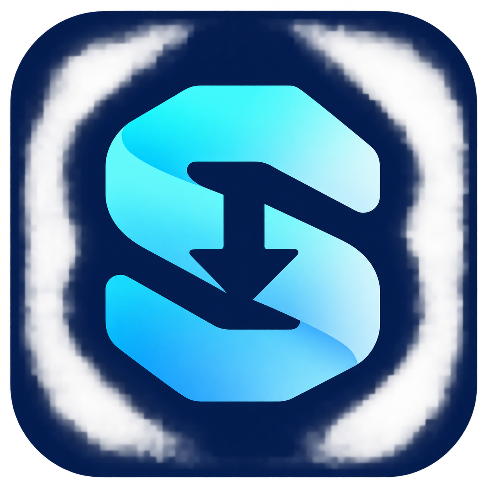

<div align="center">
  
  <h1>SDM</h1>
  <p><strong>Windows için kişisel indirme yöneticisi.</strong></p>
  <p>Dosyaları düzenle. Videoda kaliteyi seç. İndirmeleri tek yerden takip et.</p>
  <p>Windows 10 / 11 · Chrome ve Opera · Sürüm 0.3.0</p>
  <p><a href="https://github.com/EmreGUNDOGAN/SDM/releases/tag/v0.3.0">Kurulum paketini indir</a> · <a href="SECURITY-REVIEW.md">Doğrulama bilgileri</a></p>
</div>

---

SDM; paralel dosya indirmeyi, tarayıcı entegrasyonunu ve video/MP3 indirmeyi
beyaz bir masaüstü arayüzünde birleştirir. Bu depo kişisel kullanım için
geliştirilen sürümün kaynak kodunu ve kurulum tarifini içerir.

## Özellikler

| Özellik | Nasıl çalışır? |
|---|---|
| Paralel indirme | Sunucu destekliyorsa dosya birden fazla HTTP bağlantısıyla indirilir. |
| İndirme takibi | Boyut, indirilen miktar, kalan boyut, yüzde, hız ve yaklaşık süre gösterilir. |
| Detay penceresi | Yeni indirmede açılır; bağlantıları, duraklat/devam/iptal seçeneklerini gösterir. |
| Düzenlenebilir tablo | Görünür sütunlar seçilir ve tercihler kaydedilir. |
| Video düğmesi | Desteklenen video sayfalarında “SDM ile indir” düğmesi görünür. |
| Gerçek kalite listesi | Videoda bulunan çözünürlükler listelenir; ayrı ses/görüntü birleştirilir. |
| MP3 | Yalnızca ses indirilip MP3'e dönüştürülebilir. |
| Dosya yakalama | Uygun tarayıcı indirmeleri SDM'ye aktarılır; aktarım reddedilirse tarayıcı devam eder. |
| Sistem tepsisi | Pencere kapatılsa da uygulama arka planda çalışabilir. |

## Kurulum

1. **SDM-Setup-0.3.0.exe** dosyasını çalıştır.
2. Kullanacağın **Chrome / Opera eklentisi** seçeneğini işaretle.
3. Açılan yönergeden tarayıcıda **Geliştirici modu → Paketlenmemiş yükle** adımını tamamla.
4. Kurulum klasöründeki `extension` klasörünü seç.

Varsayılan klasör: `%LOCALAPPDATA%\Programs\SDM`.
Python, FFmpeg veya Deno'yu ayrıca kurmak gerekmez; setup bunları içerir.
Mağaza dışı eklentinin son yükleme onayı tarayıcıda bir kez verilmelidir.
Güncellemeden sonra eklentiyi yeniden yükle ve açık video sayfasını yenile.

## Kullanım

- **Dosya:** Normal Download düğmesine bas veya SDM'de URL Ekle'yi kullan.
- **Video:** Videonun sağ üstündeki SDM düğmesine tıkla, kaliteyi veya MP3'ü seç.
- **Takip:** Detay penceresini kullan; gizlediğin pencereyi indirmeye çift tıklayarak aç.
- **Tablo:** Sütunlar menüsünden görmek istediğin alanları seç.
- **Yakalama:** Otomatik aktarımı Ayarlar'dan açıp kapat.

Hız, kısa aralıklı anlık değerler yerine zaman ağırlıklı ortalamayla gösterilir.
Kalan süre bir tahmindir; ağ ve sunucu koşulları değiştikçe güncellenir.

## Destek ve sınırlar

Video entegrasyonu YouTube, Vimeo, Dailymotion, TikTok, Instagram, X/Twitter,
Facebook, Twitch ve SoundCloud sayfalarında etkinleştirilmiştir. Her sitede,
her içerikte indirme garantisi verilmez. DRM, oturum, bölge ve sunucu
kısıtlamaları uygulanabilir.

Tarayıcı çerezleri ve şifreler okunmaz. Oturum isteyen dosyalar, `blob:`
bağlantıları ve özel ağ adresleri otomatik aktarılmaz; tarayıcı kullanılabilir.
Gerektiğinde ses ve video MKV kabında birleştirilir. Altyazı indirme varsayılan
olarak kapalıdır.

## Güvenlik ve doğrulama

- Tarayıcı köprüsü yalnızca yerel makinede çalışır; eklenti kimliği ve gizli bağlantı anahtarı doğrulanır.
- Dosya aktarımında URL ve yönlendirmeler özel/yerel ağ adreslerine karşı kontrol edilir.
- Kaynak incelemesinde gizli veri toplama veya uzaktan komut alma davranışı bulunmadı.
- 18 regresyon testi ve yerel Windows arayüz kontrolleri geçti.
- Chromium'da normal dosya yakalama ve başarısız aktarımda tarayıcıya dönüş test edildi.
- Paketlenmiş uygulamada gerçek YouTube video/MP3 indirmesi ve kurulum/kaldırma testi geçti.

Bu kontroller bir güvenlik sertifikası değildir. Uygulama ve setup dijital
olarak imzalanmamıştır. İndirme geçmişi ve adresler yerel `.sdm` klasöründe
tutulur. Ayrıntılar: [SECURITY-REVIEW.md](SECURITY-REVIEW.md).

## Kaynaktan çalıştırma ve derleme

```powershell
python -m venv .venv
.\.venv\Scripts\python.exe -m pip install -r requirements-lock.txt
.\.venv\Scripts\python.exe main.py
```

Setup oluşturmak için FFmpeg/ffprobe ve Deno'yu `tools` klasörüne hazırlayıp
Inno Setup derleyicisinin konumunu ver:

```powershell
.\build.ps1 -InnoCompiler "C:\Program Files (x86)\Inno Setup 6\ISCC.exe"
```

Araçların kaynakları ve lisansları [tools/SOURCE-NOTICES.md](tools/SOURCE-NOTICES.md)
dosyasındadır. Üretilen kurulum `dist` klasörüne yazılır.

## Kaynak ve lisans bildirimleri

SDM, açık kaynak bir Windows indirme yöneticisinin kişisel uyarlamasıdır.
Önceki kaynak atıfları ve lisans açıklamaları korunmuştur:
[UPSTREAM-NOTICES.md](UPSTREAM-NOTICES.md). Üçüncü taraf bileşenler kendi
lisanslarıyla kullanılır; proje markasının değiştirilmesi bu hakları değiştirmez.
