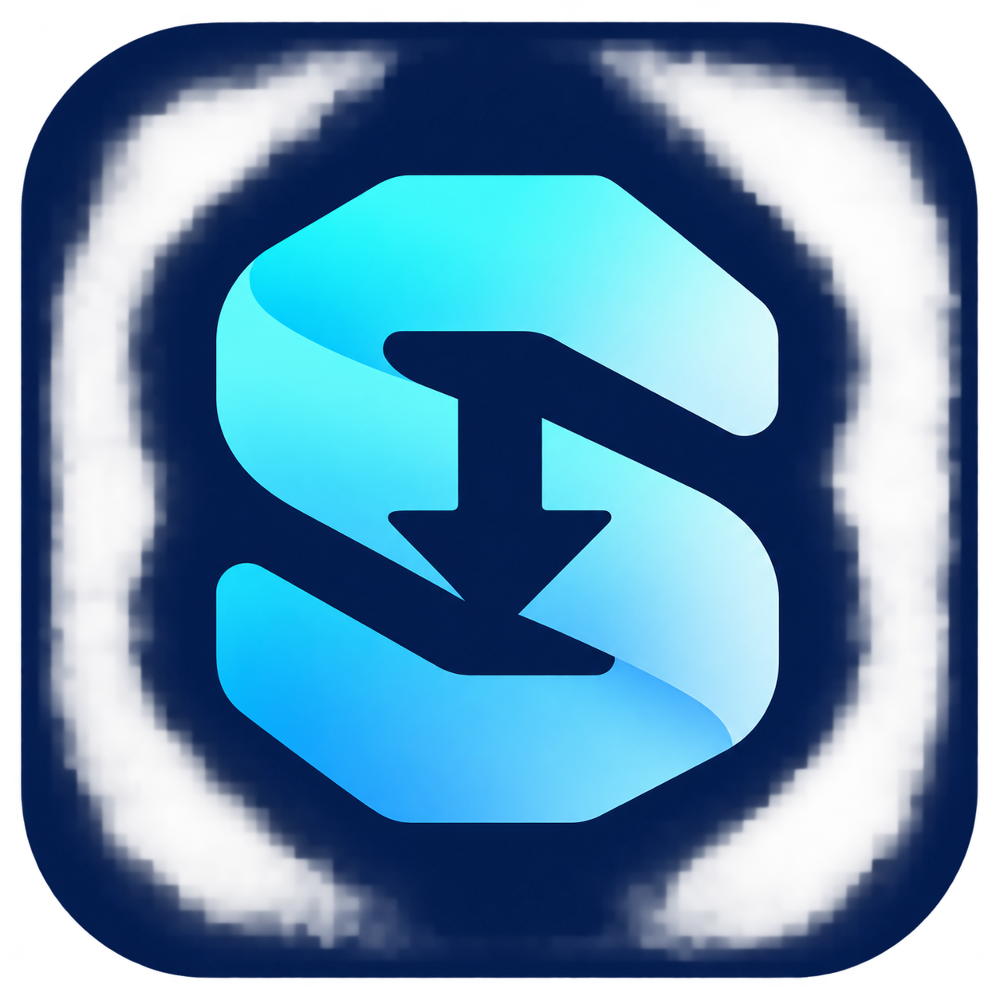

<div align="center">
  
  <h1>SDM</h1>
  <p><strong>Windows için kişisel indirme yöneticisi.</strong></p>
  <p>Dosyaları düzenle. Videoda kaliteyi seç. İndirmeleri tek yerden takip et.</p>
  <p>Windows 10 / 11 · Chrome ve Opera · Sürüm 1.0.1</p>
  <p><a href="https://github.com/EmreGUNDOGAN/SDM-Updates/releases/tag/v1.0.1">Kurulum paketini indir</a> · <a href="SECURITY-REVIEW.md">Doğrulama bilgileri</a></p>
</div>

---

1.0.0; Pano ve Yörünge görünümlerini, müzik modunu, sayfa tarayıcıyı ve
İstatistik penceresini ekler.
[1.0.1 değişiklikleri](RELEASE-NOTES-1.0.1.md) · [1.0.0 değişiklikleri](RELEASE-NOTES-1.0.0.md) · [0.5.1 değişiklikleri](RELEASE-NOTES-0.5.1.md) · [0.5.0 değişiklikleri](RELEASE-NOTES-0.5.0.md).

Görünüm ve renk modu Ayarlar → Genel'de bağımsız seçilir. Atlas tablo ve
seçim paneli, Odak kartlar ve ayrıntı çekmecesi kullanır. Pano açık renkli
panolar, Yörünge koyu ve köşe çizgili paneller kullanır; Yörünge yalnız koyu
modda açılır. Odak'ta Ayarlar ana
alana açılır; kaydedilmemiş değişiklikte Kaydet/Kaydetme/Vazgeç seçimi sunulur.
Yedekten geri yükleme Kaydet'e basmadan uygulanmaz. Sayı biçimi tercihi korunur.

SDM; paralel dosya indirmeyi, tarayıcı entegrasyonunu ve video/MP3 indirmeyi
açık veya koyu temalı modern bir masaüstü arayüzünde birleştirir. Bu depo kişisel kullanım için
geliştirilen sürümün kaynak kodunu ve kurulum tarifini içerir.

## Özellikler

| Özellik | Nasıl çalışır? |
|---|---|
| Paralel indirme | Sunucu destekliyorsa dosya birden fazla HTTP bağlantısıyla indirilir. |
| İndirme takibi | Boyut, indirilen miktar, kalan boyut, yüzde, hız ve yaklaşık süre gösterilir. |
| Detay penceresi | Yeni indirmede açılır; bağlantıları, duraklat/devam/iptal seçeneklerini gösterir. |
| Düzenlenebilir tablo | Görünür sütunlar seçilir ve tercihler kaydedilir. |
| Video düğmesi | Desteklenen video sayfalarında “SDM ile indir” düğmesi görünür. |
| Gerçek kalite listesi | Videoda bulunan çözünürlükler listelenir; ayrı ses/görüntü birleştirilir. |
| MP3 | Yalnızca ses indirilip MP3'e dönüştürülebilir. |
| Dosya yakalama | Uygun tarayıcı indirmeleri SDM'ye aktarılır; aktarım reddedilirse tarayıcı devam eder. |
| Modern görünüm | Açık/koyu/sistem teması, tutarlı ikonlar ve kompakt durum paneli. |
| İndirmeden önce seçim | Şimdi indir, kuyruğa ekle veya iptal et; uygun dosyada tarayıcıda devam et. |
| Site tercihleri | Canva varsayılan hariç; site ve dosya türü istisnaları düzenlenebilir. |
| Geçici durdurma | Eklentiden 15 dakika, 1 saat veya tekrar açılana kadar yakalamayı kapat. |
| Video hızlandırma | Uygun HTTP akışlarında paralel Range; HLS/DASH için eşzamanlı parçalar. |
| Kuyruk ve zamanlama | Kuyruğu başlat/duraklat; uygulama açıkken zamanlı başlat ve tamamlanınca kapanma. |
| Çoklu bağlantı | Bağlantıları yapıştır veya sürükle-bırak; video listesinden seç. |
| Tamamlanma | Aç / Klasörü göster penceresi, isteğe bağlı bildirim ve SHA-256 kontrolü. |
| Ayar yedeği | Site, sütun, klasör ve görünüm tercihlerini dışa aktar/geri yükle. |
| GitHub güncellemesi | Public SDM-Updates deposundan tokensız güncelleme; setup SHA-256 ile doğrulanır. |
| Yeni araçlar | Adlandırılmış kuyruklar, tekrarlayan takvim, öncelik, rahatlat modu ve masaüstü HUD’u. |
| Dosya işlemleri | Otomatik ZIP/RAR çıkarma; altyazı seçimi; kesme/dönüştürme; klasör önizlemesi ve bağlantı kontrolü. |
| Kaspersky | Tamamlandı penceresinde Virüs tarat; tarama yalnızca düğmeyle başlar. |
| Dört görünüm | Atlas, Odak, Pano ve Yörünge; pencereler, ayarlar ve HUD seçilen görünümle açılır. |
| Müzik modu | YouTube Music'te SDM ile MP3; 128–320 kb/sn, Sanatçı/Albüm klasörü, ID3 etiketi ve kapak. |
| Sayfa tarayıcı | Eklentiden etkin sayfadaki bağlantı ve medyayı listele; seçtiklerini toplu indirmeye gönder. |
| İstatistik | Bugün, 7 gün, 30 gün ve tüm zaman için yerel indirme listesinden özet. |
| Sistem tepsisi | Pencere kapatılsa da uygulama arka planda çalışabilir. |

## Kurulum

1. **SDM-Setup-1.0.1.exe** dosyasını çalıştır.
2. Kullanacağın **Chrome / Opera eklentisi** seçeneğini işaretle.
3. Açılan yönergeden tarayıcıda **Geliştirici modu → Paketlenmemiş yükle** adımını tamamla.
4. Kurulum klasöründeki `extension` klasörünü seç.

Varsayılan klasör: `%LOCALAPPDATA%\Programs\SDM`.
Python, FFmpeg veya Deno'yu ayrıca kurmak gerekmez; setup bunları içerir.
Mağaza dışı eklentinin son yükleme onayı tarayıcıda bir kez verilmelidir.
0.3.1 eklentisinden geçerken tarayıcıda bir defa Yeniden yükle kullan. Sonraki güncellemelerde eklentinin Eklentiyi yenile düğmesini kullan; açık video sayfasını yenile.

## Kullanım

- **Dosya:** Tarayıcıda Download düğmesine bas; açılan SDM penceresinde Şimdi indir veya Kuyruğa ekle seç. SDM içinden Yeni indirme de kullanılabilir.
- **Video:** Videonun sağ üstündeki SDM düğmesine tıkla, kaliteyi veya MP3'ü seç.
- **Takip:** Detay penceresini kullan; gizlediğin pencereyi indirmeye çift tıklayarak aç.
- **Tablo:** Sütunlar menüsünden görmek istediğin alanları seç.
- **Yakalama:** Ayarlar → Tarayıcı bölümünden site/uzantı tercihlerini düzenle; eklentiden geçici durdur.
- **Güncelleme:** Ayarlar → Güncelleme bölümünden kontrol et. Token gerekmez; kurulum onayınla başlar.
- **Tema:** Ayarlar → Genel bölümünden light / dark / system seç.
- **Yeni sürüm:** [1.0.1 değişiklikleri](RELEASE-NOTES-1.0.1.md).

Hız, kısa aralıklı anlık değerler yerine zaman ağırlıklı ortalamayla gösterilir.
Kalan süre bir tahmindir; ağ ve sunucu koşulları değiştikçe güncellenir.

## Destek ve sınırlar

Video entegrasyonu YouTube, Vimeo, Dailymotion, TikTok, Instagram, X/Twitter,
Facebook, Twitch ve SoundCloud sayfalarında etkinleştirilmiştir. Her sitede,
her içerikte indirme garantisi verilmez. DRM, oturum, bölge ve sunucu
kısıtlamaları uygulanabilir.

Tarayıcı çerezleri ve şifreler okunmaz. Site istisnaları için kaynak sayfanın adresi değerlendirilir; tarayıcı geçmişi kaydedilmez. Oturum isteyen dosyalar, `blob:`
bağlantıları ve özel ağ adresleri otomatik aktarılmaz; tarayıcı kullanılabilir.
Gerektiğinde ses ve video MKV kabında birleştirilir. Altyazı indirme varsayılan
olarak kapalıdır.

## Güvenlik ve doğrulama

- Tarayıcı köprüsü yalnızca yerel makinede çalışır; eklenti kimliği ve gizli bağlantı anahtarı doğrulanır.
- Dosya aktarımında URL ve yönlendirmeler özel/yerel ağ adreslerine karşı kontrol edilir.
- Kaynak incelemesinde gizli veri toplama veya uzaktan komut alma davranışı bulunmadı.
- 41 motor/güvenlik regresyon testi ve yerel Windows arayüz kontrolleri geçti.
- Chromium'da normal dosya yakalama ve başarısız aktarımda tarayıcıya dönüş test edildi.
- Önceki paketli sürümde gerçek YouTube video/MP3 ve kurulum/kaldırma testleri geçti. 1.0.1 setup GitHub Actions üzerinde üretilir.

Bu kontroller bir güvenlik sertifikası değildir. Uygulama ve setup dijital
olarak imzalanmamıştır. İndirme geçmişi ve adresler yerel `.sdm` klasöründe
tutulur. Ayrıntılar: [SECURITY-REVIEW.md](SECURITY-REVIEW.md).

## Kaynaktan çalıştırma ve derleme

```powershell
python -m venv .venv
.\.venv\Scripts\python.exe -m pip install -r requirements-lock.txt
.\.venv\Scripts\python.exe main.py
```

Setup oluşturmak için FFmpeg/ffprobe ve Deno'yu `tools` klasörüne hazırlayıp
Inno Setup derleyicisinin konumunu ver:

```powershell
.\build.ps1 -InnoCompiler "C:\Program Files (x86)\Inno Setup 6\ISCC.exe"
```

Araçların kaynakları ve lisansları [tools/SOURCE-NOTICES.md](tools/SOURCE-NOTICES.md)
dosyasındadır. Üretilen kurulum `dist` klasörüne yazılır.

## Kaynak ve lisans bildirimleri

SDM, açık kaynak bir Windows indirme yöneticisinin kişisel uyarlamasıdır.
Önceki kaynak atıfları ve lisans açıklamaları korunmuştur:
[UPSTREAM-NOTICES.md](UPSTREAM-NOTICES.md). Üçüncü taraf bileşenler kendi
lisanslarıyla kullanılır; proje markasının değiştirilmesi bu hakları değiştirmez.
